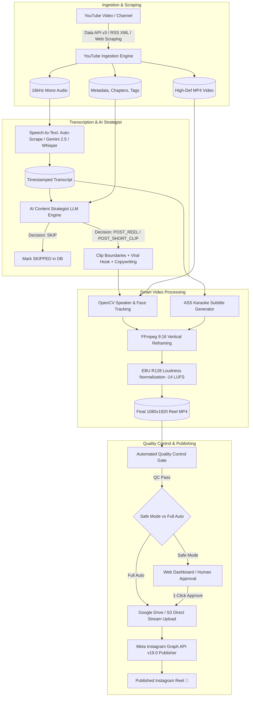

# 🚀 AutomatorYT2Insta — AI-Powered YouTube &rarr; Instagram Content Repurposing System

[](https://www.python.org/downloads/)
[](https://fastapi.tiangolo.com)
[](https://opencv.org/)
[](https://ffmpeg.org/)
[](https://developers.facebook.com/)
[](https://docs.pytest.org/)

An advanced, production-grade, highly automated pipeline that repurposes long-form and short YouTube videos into viral, high-retention 9:16 Instagram Reels.

Unlike simple video rippers, **AutomatorYT2Insta** acts as an **Autonomous AI Content Strategist**: it analyzes hook strength, speech transcripts, video pacing, extracts standalone educational/entertaining segments, centers the speaker using **Computer Vision (OpenCV Face Tracking)**, normalizes audio to broadcasting standards (**EBU R128**), burns in **Karaoke-styled animated captions**, and publishes via the official **Meta Instagram Graph API** (with automated **Google Drive** cloud streaming support).

---

## 📑 Table of Contents
- [Architecture & Workflow](#-architecture--workflow)
- [Key Advancements & Capabilities](#-key-advancements--capabilities)
- [Dual Automation Modes](#-dual-automation-modes)
- [Quick Start Guide](#-quick-start-guide)
- [Cloud Storage: Google Drive Setup](#-cloud-storage-google-drive-setup)
- [Meta Instagram Graph API Setup](#-meta-instagram-graph-api-setup)
- [Batch Migration for Existing 30–40 Videos](#-batch-migration-for-existing-3040-videos)
- [Agent Skills & Antigravity Autonomous Usage](#-agent-skills--antigravity-autonomous-usage)
- [Testing & Quality Assurance](#-testing--quality-assurance)
- [Docker Deployment](#-docker-deployment)

---

## 🏗 System Architecture



---

## ⚡ Key Advancements & Capabilities

### 1. 🧠 Autonomous AI Content Strategist (Gemini 2.5 & GPT-4o)
- **Hook Detection**: Scans transcript & audio for provocative opening statements, curiosity gaps, and key punchlines in the first 0–3 seconds.
- **Standalone Coherence**: Ensures extracted clips make complete sense without needing full 20-minute video context.
- **Structured Pydantic Outputs**:
  - `POST_FULL_REEL`: Original video is already <= 90s and high retention.
  - `POST_SHORT_CLIP`: Extracted 20–60s standalone segment.
  - `POST_MULTIPLE_CLIPS`: Multiple self-contained lessons.
  - `SKIP`: Video is too technical, lacks a hook, or unsuitable for Reels.
- **Deterministic Heuristic Fallback**: Runs offline when API keys are not supplied.

### 2. 🎥 Computer Vision 9:16 Reframing & Face Tracking
- **Smart Face Tracking (`smart_face_track`)**: Samples frames with OpenCV to locate the speaker's face, applies temporal smoothing, and centers the 9:16 vertical crop directly on the speaker.
- **Cinematic Blur-Stack (`blur_stack`)**: Background scaled to 1080x1920 with Gaussian blur (`gblur=sigma=20`), crisp 16:9 foreground overlay.
- **Center Crop (`center_crop`)**: High-speed direct 9:16 crop.

### 3. ✍️ Dynamic Karaoke-Style Subtitles
- Generates **Advanced SubStation Alpha (`.ass`)** and `.srt` subtitles.
- Features large, high-contrast typography (Arial Black / Montserrat) positioned in the safe lower-third with yellow active-word highlights and dark outlines for maximum retention.

### 4. 🌐 Web Scraping & Zero-Quota Ingestion
- Ingests video metadata, channel video feeds, chapters, tags, and creator transcripts **without consuming Google API quota** via public RSS/Atom feeds and direct subtitle scrapers.

### 5. 🔊 Broadcasting Audio Standards
- Normalizes speech audio using FFmpeg's `loudnorm` filter to **-14 LUFS** (EBU R128 standard), preventing distortion or quiet audio on mobile speakers.

### 6. 🛡 Pre-Flight Quality Control (QC) Layer
- Validates file sizes (>10KB), H.264 video, AAC audio, duration limits (15s–90s), Instagram caption limits (<=2200 characters), and hashtag counts (<=30).

---

## 🎛 Dual Automation Modes

| Feature | Safe Mode (`AUTOMATION_MODE=SAFE`) | Full Auto Mode (`AUTOMATION_MODE=FULL_AUTO`) |
| :--- | :--- | :--- |
| **Workflow** | AI prepares clip & caption &rarr; User reviews in Dashboard &rarr; 1-Click Publish | AI prepares clip &rarr; If confidence &ge; threshold (e.g. 0.85) & QC passes &rarr; Publishes immediately |
| **Human Control** | Full editorial control, caption editing, preview before posting | Zero-touch, hands-off autonomous operation |
| **Best For** | Initial testing, branded channels, high-stakes accounts | Scale, daily high-volume content syndication |

---

## 🚀 Quick Start Guide

### 1. Prerequisites
- macOS, Linux, or Windows (WSL2)
- Python 3.10+
- FFmpeg (bundled automatically via `imageio-ffmpeg` — zero manual installation required!)

### 2. Clone & Setup
```bash
git clone https://github.com/givemehat/AutomatorYT2Insta.git
cd AutomatorYT2Insta

# Create & activate Python virtual environment
python3 -m venv venv
source venv/bin/activate

# Install dependencies
pip install -r requirements.txt
```

### 3. Environment Configuration
```bash
cp .env.example .env
```
Edit `.env` with your preferred settings:
```env
# Operating Mode
AUTOMATION_MODE=SAFE
AUTO_PUBLISH_THRESHOLD=0.85

# AI Engine
LLM_PROVIDER=gemini
GEMINI_API_KEY=your_gemini_api_key_here
GEMINI_MODEL=gemini-2.5-flash

# Video Reframing
REFRAME_STYLE=smart_face_track
ENABLE_SUBTITLES=True
SUBTITLE_STYLE=karaoke_highlight
```

### 4. Start the Application
```bash
uvicorn app.main:app --host 0.0.0.0 --port 8000 --reload
```
Open **[http://localhost:8000](http://localhost:8000)** in your browser to access the Web Dashboard!

---

## ☁️ Cloud Storage: Google Drive Setup

Meta's Instagram Graph API requires video files to be hosted on a public HTTPS URL during container creation. With Google Drive integration, videos upload straight to your Google Drive and generate direct streaming URLs!

1. Go to [Google Cloud Console](https://console.cloud.google.com/) and enable the **Google Drive API**.
2. Create a **Service Account** under **Credentials** and download its JSON key.
3. Save the JSON file in your project root as:
   ```text
   google_drive_credentials.json
   ```
4. Create a folder in Google Drive (e.g. `Instagram_Reels`) and share it with the Service Account email.
5. In your `.env`:
   ```env
   STORAGE_BACKEND=gdrive
   GOOGLE_DRIVE_FOLDER_ID=your_google_drive_folder_id_here
   ```

---

## 📸 Meta Instagram Graph API Setup

1. Convert your Instagram account to a **Professional / Creator Account**.
2. Link your Instagram account to a **Facebook Page**.
3. Create a **Meta Developer App** (Type: *Business*) at [developers.facebook.com](https://developers.facebook.com/).
4. Add permissions: `instagram_basic`, `instagram_content_publish`, `pages_show_list`, `pages_read_engagement`.
5. Generate a **Long-Lived User Access Token** and set in `.env`:
   ```env
   INSTAGRAM_ACCOUNT_ID=your_instagram_business_account_id
   META_USER_ACCESS_TOKEN=your_long_lived_token
   ```
*(Note: If Instagram credentials are not configured, the system operates in **Simulation Mode** so you can preview everything in the dashboard without errors).*

---

## 📦 Batch Migration for Existing 30–40 Videos

To automatically migrate and repurpose your existing YouTube channel catalog:

```bash
python scripts/migrate_existing.py --channel-id "YOUR_CHANNEL_ID_OR_HANDLE" --max 40 --delay 5 --reframe-style smart_face_track
```

### CLI Arguments:
- `--channel-id`: YouTube Channel ID or handle (e.g. `UC...` or `@yourhandle`)
- `--max`: Number of videos to ingest (default: `40`)
- `--delay`: Delay in seconds between videos to prevent rate limiting (default: `5`)
- `--reframe-style`: `smart_face_track`, `blur_stack`, or `center_crop`

---

## 🤖 Agent Skills & Antigravity Autonomous Usage

This repository includes a dedicated **Antigravity Agent Skill** located at:
👉 [`skills/yt-to-insta-automation/SKILL.md`](skills/yt-to-insta-automation/SKILL.md)

AI agents can autonomously:
1. Ingest YouTube videos via API (`POST /api/videos/ingest`).
2. Read generated clip decisions and confidence scores (`GET /api/clips`).
3. Approve and publish to Instagram (`POST /api/clips/{clip_id}/approve`).
4. Re-render clips with custom visual styling (`POST /api/clips/{clip_id}/re-render`).
5. Monitor channel health metrics (`GET /api/system/metrics`).

---

## 🧪 Testing & Quality Assurance

Run the comprehensive 13-suite automated test matrix:
```bash
pytest -v
```

### Test Coverage:
- `test_youtube.py`: Video ID parsing across all URL shapes, RSS channel scraping.
- `test_subtitles.py`: ASS and SRT generation with karaoke styles.
- `test_ai_decision.py`: Pydantic schema validation, chapter-aware heuristic fallback.
- `test_video_processor.py`: Synthetic 16:9 video rendering, speaker horizontal center detection, 9:16 reframe, QC verification.
- `test_quality_control.py`: Duration bounds, codec verification, caption/hashtag limits.
- `test_google_drive.py`: Cloud upload fallback handling.
- `test_api.py`: FastAPI routes, dashboard HTML response, metrics, and clips endpoints.

---

## 🐳 Docker Deployment

Run the complete stack inside a production Docker container:

```bash
docker-compose up --build -d
```

---

## 📄 License
MIT License. Crafted with precision for high-retention content automation.
